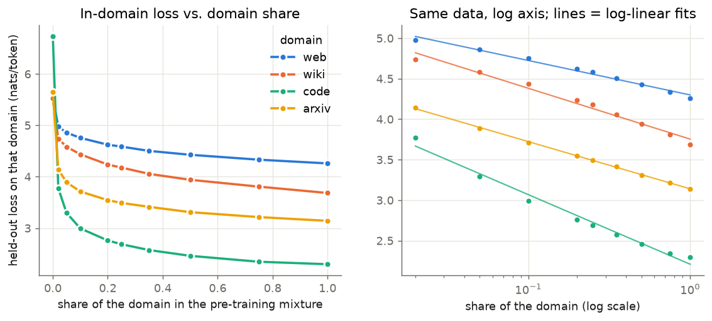
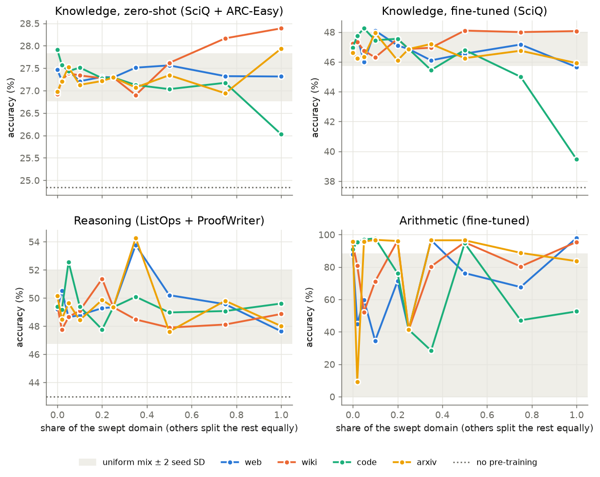
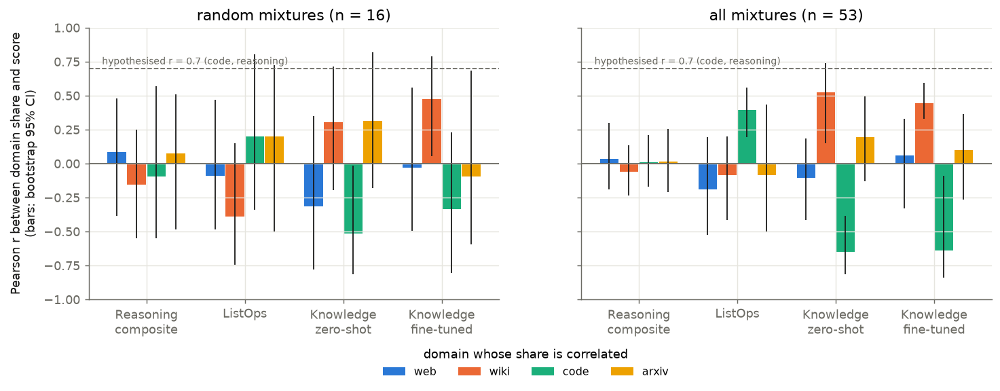
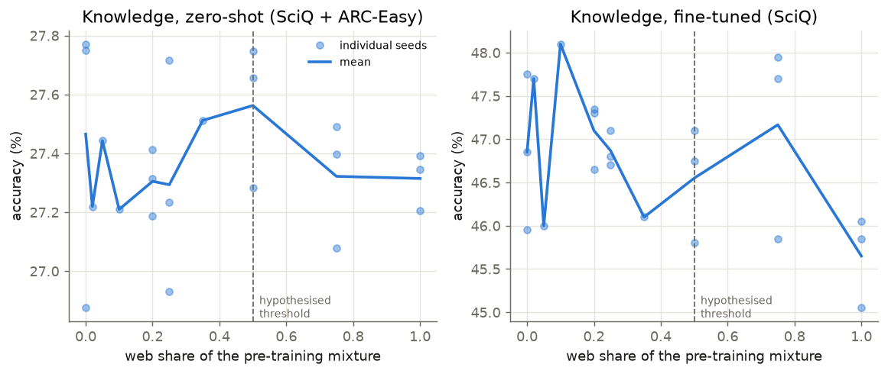
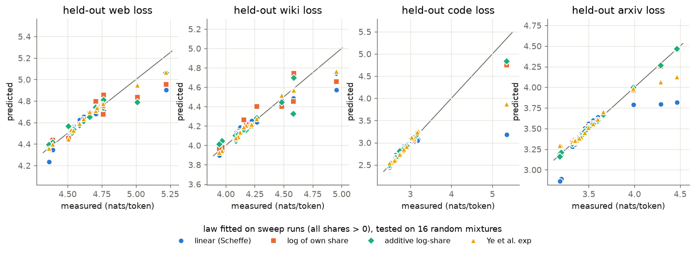

# Data Mixture Laws: Predicting Downstream Performance from Pre-Training Corpus Composition

## 1. Executive Summary

**Question.** At a fixed model size and token budget, does downstream performance follow a log-linear law
in each domain's share of the pre-training mixture, saturating around 20%; is code the strongest driver
of reasoning performance (r > 0.7); and does more than 50% web text hurt knowledge-intensive tasks?

**What was done.** 81 small GPT language models (17M parameters, 60M tokens each) were trained from
scratch on controlled mixtures of four domains — web (C4), Wikipedia (WikiText-103), code (GitHub Python)
and scientific papers (arXiv) — and each was evaluated on held-out loss per domain, zero-shot and
fine-tuned knowledge QA, and fine-tuned reasoning probes. 53 distinct mixtures; 14 of them with 3 seeds.

**Key finding.** The hypothesis holds for language-modelling loss and essentially nowhere else.
Held-out loss on a domain is log-linear in that domain's share (R² 0.98–0.9996 against 0.67–0.87 for a
linear fit), but with **no saturation at 20%**: the log-linear trend continues to 100%. Downstream
task accuracy, by contrast, is almost **flat** across mixtures — most differences are within seed noise —
so none of the three downstream claims is supported:

| Claim | Verdict at this scale | Evidence |
|---|---|---|
| H1 log-linear in domain share | **Supported for loss; not for downstream accuracy** | log beats linear by 2.3–22× in leave-one-out error for in-domain loss; for downstream scores no law beats a constant by more than noise |
| H2 saturation / diminishing returns above 20% | **Not supported as stated** | loss keeps falling 0.36–0.55 nats from 20% → 100% (50–100× seed SD); fitted saturation point is 100% for 3 of 4 domains |
| H3 code → reasoning, r > 0.7 | **Not supported** | r = −0.10 (95% CI −0.55 to 0.57) on 16 random mixtures; r = 0.01 on all 53. Code has a small positive association with ListOps only (r = 0.39) |
| H4 web > 50% hurts knowledge tasks | **Not supported** | 75% web is indistinguishable from 25–50%; only 100% web shows a −1.2-point drop on one of two measures (p = 0.04 uncorrected, 3 seeds) |

**Practical implication, with a large caveat.** In this regime a mixture can be tuned for *loss* with a
simple log-share law fitted on ~30 small runs, but loss differences of this kind did not translate into
measurable downstream differences unless a domain was pushed to ≥ 75% (pure code costs 7.4 points of
fine-tuned SciQ). The caveat is scale and instrument sensitivity: these are 17M-parameter models whose
zero-shot QA is 2–3 points above chance, so the downstream nulls show that the effects are *small relative
to our noise here*, not that they are absent in LLM-scale training.

## 2. Research Question & Motivation

**Hypothesis as given.** "Downstream performance follows a log-linear relationship with domain proportion
up to a saturation point, with diminishing returns above 20% for any single domain. Code data shows the
strongest positive transfer to reasoning benchmarks (r > 0.7), while web text proportion beyond 50%
degrades performance on knowledge-intensive tasks."

**Why it matters.** Corpus composition is chosen largely by heuristics. A simple law would let mixtures be
chosen from a few small runs.

**Gap.** Prior mixing laws model validation loss (Ye et al. 2025; Shukor et al. 2025); RegMix regresses a
loss target and reports that web text correlates best with downstream performance; Aryabumi et al. show
code helps reasoning using a handful of mixtures. None tests the *shape* of the dose–response on
downstream tasks, a 20% saturation point, or a 50% web threshold. See `literature_review.md`. Note that
the automated resource-finding stage was skipped for this workspace, so the review is abstract-level and
was compiled in-session.

## 3. Experimental Setup

### 3.1 Pre-training
| | |
|---|---|
| Domains | web = `allenai/c4` (en); wiki = WikiText-103; code = `codeparrot/codeparrot-clean` (Python); arxiv = `ccdv/arxiv-summarization` article bodies |
| Pools | 128.9M training tokens per domain (equalised), separate held-out documents |
| Tokenizer | one byte-level BPE, 16,384 tokens, trained on a balanced sample |
| Model | decoder-only transformer, 6 layers × 384 width × 6 heads, context 256, tied embeddings, **17.0M parameters** |
| Budget | **60M tokens per run** (3,662 steps × 64 sequences × 256 tokens), identical for every mixture |
| Optimiser | AdamW, lr 1e-3, 3% warm-up, cosine to 10%, weight decay 0.1, betas (0.9, 0.95), clip 1.0, bf16 autocast |
| Mixing | each training sequence is drawn from domain *d* with probability *p_d* (token proportions) |

### 3.2 Mixture design (81 runs, 53 distinct mixtures)
- **Single-domain sweeps**: for each domain, share p ∈ {0, 0.02, 0.05, 0.1, 0.2, 0.35, 0.5, 0.75, 1}, the
  other three domains splitting 1 − p equally. The uniform mixture (0.25 each) lies on all four sweeps.
- **Random mixtures**: 16 draws from Dirichlet(1,1,1,1), used as an unbiased sample for correlations and
  as a held-out test set for mixture laws.
- **Seed replicates** (3 seeds each): uniform; every p = 0 and p = 1 model; web at 0.2, 0.5, 0.75; code at
  0.2, 0.5. 14 replicated mixtures, 28 degrees of freedom for the noise estimate.

### 3.3 Evaluation
| Family | Task | Protocol | Size |
|---|---|---|---|
| Loss | held-out loss on each domain | nats/token, non-overlapping windows | 0.27–1.0M tokens |
| Knowledge, zero-shot (**K_zs**) | SciQ, ARC-Easy | answer with highest length-normalised log-likelihood after `Question: …\nAnswer:` | 13,679 + 5,197 items |
| (reported, not in composite) | ARC-Challenge, OpenBookQA, CommonsenseQA | same | 2,590 / 5,957 / 10,962 |
| Knowledge, fine-tuned (**K_ft**) | SciQ closed-book | 400 fine-tuning steps on train answers, then MC on val+test | 2,000 items |
| Reasoning (**R**) | ListOps (generated), ProofWriter | 500 fine-tuning steps each (4,000 / 3,000 examples), exact-match accuracy | 2,000 / 1,500 items |
| (reported, not in composite) | 3-digit arithmetic | 1,500 fine-tuning steps | 2,000 items |

Fine-tuning uses lr 3e-4, loss on answer tokens only, and the same data order for every checkpoint.
Re-running the evaluation of a checkpoint reproduces every number exactly (checked on `rand03_s0`).

**How the composites were chosen.** Using only the uniform-mixture pilot and a randomly initialised
control, before any mixture comparison: K_zs keeps the two zero-shot tasks that were above chance; K_ft is
the pre-planned fallback for weak zero-shot signal; R keeps the two fine-tuned tasks on which pre-training
helped. Arithmetic is excluded because pre-training *hurt* it in the pilot (see 5.5).

**Baselines.** Uniform mixture; pure-domain and leave-one-out models; a random-init model for all
fine-tuned probes; chance for multiple choice; a linear fit as the null for curve shape; the Ye et al.
exponential mixing law and a linear (Scheffé) mixture model for multi-domain prediction.

### 3.4 Compute and cost
4 × NVIDIA RTX A6000 (48 GB), **shared with three other concurrent jobs** for most of the session, which
forced the model/budget reduction described in `planning.md` (Deviations). Total: 11.4 GPU-hours of
pre-training and 3.8 GPU-hours of evaluation (4–21 min of training per run depending on contention). Batch
size 64 × 256 tokens with bf16 mixed precision. No LLM API was used (cost $0): the hypothesis concerns
pre-training, so models were trained rather than queried. Python 3.14.2, PyTorch 2.14.1+cu130,
NumPy 2.5.3, SciPy 1.18.1, pandas 3.0.6, tokenizers 0.23.3.

## 4. Results

All tables are in `results/analysis.md`; per-run numbers in `results/runs.csv`.

### 4.1 How much signal is there? (noise floor)

| Metric | Range across 53 mixtures | SD across mixtures | SD across seeds | Ratio |
|---|---|---|---|---|
| In-domain loss (runs containing the domain) | 0.7–1.5 nats | — | 0.004–0.008 | > 100 |
| K_zs (zero-shot knowledge) | 26.0 – 28.7% | 0.39 pts | 0.26 pts | 1.5 |
| K_ft (fine-tuned SciQ) | 39.0 – 49.1% | 1.35 pts | 0.55 pts | 2.4 |
| ListOps | 35.5 – 42.2% | 1.03 pts | 0.76 pts | 1.3 |
| ProofWriter | 56.0 – 70.6% | 2.70 pts | 2.58 pts | 1.0 |
| R (reasoning composite) | 47.5 – 54.8% | 1.41 pts | 1.29 pts | 1.1 |
| Arithmetic | 7.7 – 98.5% | 25.6 pts | 23.4 pts | 1.1 |

Loss is measured two orders of magnitude more precisely than it varies. Downstream accuracy varies across
mixtures about as much as across seeds; only the knowledge measures rise clearly above noise, and that is
driven by a few extreme mixtures. For reference, the random-init control scores K_ft 37.6%, ListOps
30.1%, ProofWriter 55.9%; pre-training with the uniform mixture adds +9.3, +9.0 and +3.7 points.

### 4.2 H1 — in-domain loss is log-linear in the domain's share

*Held-out loss on each domain as its share varies (left), and the same points on a log axis with
log-linear fits (right).*

| Domain | Loss at share 0 → 0.02 → 0.2 → 1.0 | R² linear | R² log | LOO error: linear / log / exp / log+plateau | Best |
|---|---|---|---|---|---|
| web | 5.53 → 4.97 → 4.62 → 4.26 | 0.863 | 0.984 | 0.120 / 0.044 / 0.041 / 0.051 | exp ≈ log |
| wiki | 5.52 → 4.74 → 4.24 → 3.68 | 0.872 | 0.980 | 0.171 / 0.074 / 0.056 / 0.084 | exp |
| code | 6.73 → 3.77 → 2.76 → 2.30 | 0.669 | 0.984 | 0.369 / 0.095 / 0.163 / 0.074 | log+plateau |
| arxiv | 5.65 → 4.14 → 3.55 → 3.14 | 0.769 | 0.9996 | 0.208 / 0.009 / 0.092 / 0.025 | log |

(Fits use the nine shares > 0. "exp" is the one-dimensional Ye et al. form c + k·e^{t·p}.)

- The two-parameter log law beats the linear law everywhere (2.3× to 22× lower leave-one-out error) and
  is the best or near-best model in every domain. AICc agrees (log is 17–57 units below linear).
- Residuals from the log law (0.01–0.10 nats) are still larger than seed noise (0.004–0.008) for web,
  wiki and code, so the law is a good approximation, not an exact description. arXiv is essentially exact.
- **Share 0 is a cliff, not a point on the curve.** The first 2% of a domain delivers 43–67% of the total
  0 → 100% improvement; no smooth law fitted to p > 0 extrapolates to it.

### 4.3 H2 — no saturation at 20%

| Domain | Share of the 0 → 100% loss gain reached at 5% / 20% / 50% | Further gain 20% → 100% (nats) | In seed SDs | Fitted plateau start |
|---|---|---|---|---|
| web | 53% / 71% / 87% | 0.36 | 74 | 1.00 (none) |
| wiki | 51% / 70% / 86% | 0.55 | 79 | 1.00 (none) |
| code | 78% / 90% / 96% | 0.46 | 59 | 0.65 |
| arxiv | 70% / 84% / 93% | 0.40 | 98 | 1.00 (none) |

Returns diminish in the sense that any logarithm does — each doubling of a domain's share buys a
roughly constant 0.15 (web), 0.20 (wiki), 0.32 (code), 0.18 (arxiv) nats (own-share coefficients of
the law in 4.6) — but nothing special happens at
20%. A log-linear law with a plateau fits *worse* out of sample than a plain log law in three of four
domains, and where a plateau is preferred (code) it starts at about 65%.

For downstream tasks a saturation point cannot be located at all, because there is no rising segment to
saturate: between shares of 2% and 50%, K_zs, K_ft and R stay inside the ±2 SD seed band for every domain
(figure below).

*Downstream accuracy as each domain's share is swept. Grey band: uniform-mixture mean ± 2 pooled seed SD.
Points are single seeds except at replicated shares (means of 3).*

For the downstream curve shapes (16 domain × metric fits), the log law is not preferred: a linear fit has
the lowest leave-one-out error in 8 of 12 downstream cases, because the only real effects sit at the
high-share end (wiki → knowledge up, code → knowledge down), the opposite of diminishing returns. In most
of these fits R² is below 0.25, i.e. there is little to explain.

### 4.4 H3 — code is not a strong driver of reasoning scores

*Pearson correlation between each domain's share and downstream scores, on the 16 random mixtures
(pre-specified test) and on all 53 mixtures.*

| Score | Code share, random mixtures (n = 16) | Code share, all mixtures (n = 53) | Strongest domain (all mixtures) |
|---|---|---|---|
| R composite | r = −0.10 [−0.55, 0.57] | r = 0.01 [−0.17, 0.21] | none (all \|r\| < 0.07) |
| ListOps | r = 0.20 [−0.34, 0.81] | **r = 0.39 [0.19, 0.56], Holm p = 0.014** | code |
| ProofWriter | r = −0.20 | r = −0.14 | none significant |
| K_zs | r = −0.52 | **r = −0.65 [−0.82, −0.39]** | wiki (+0.52) |
| K_ft | r = −0.34 | **r = −0.64 [−0.84, −0.09]** | wiki (+0.45) |

- The hypothesised r > 0.7 is far outside what was observed for the composite. Even the upper confidence
  limit on the random mixtures (0.57) is below 0.7.
- Code does have the largest positive association with one reasoning task, ListOps, the most
  code-like of the probes (bracketed nested operators). The effect is small: a mixture regression
  predicts 41.4% (SE 0.6) for a pure-code corpus against 38.6–39.3% for the other pure corpora, and the
  seed-replicated pure-code model is +1.6 points over uniform (Welch p = 0.14, 3 vs 3 seeds).
- Removing code entirely changes nothing measurable: R is 49.4% without code and 49.4% at uniform.
- Code share is the strongest *negative* correlate of both knowledge measures, driven by high code shares
  (next section).

### 4.5 H4 — web text above 50% does not measurably hurt knowledge tasks

*Knowledge accuracy along the web sweep; dots are individual seeds.*

| Web share | Seeds | K_zs (%) | K_ft (%) | Wiki loss | arXiv loss |
|---|---|---|---|---|---|
| 0 | 3 | 27.47 ± 0.51 | 46.85 ± 0.90 | 4.18 | 3.43 |
| 0.25 (uniform) | 3 | 27.29 ± 0.40 | 46.87 ± 0.21 | 4.18 | 3.49 |
| 0.50 | 3 | 27.56 ± 0.25 | 46.55 ± 0.67 | 4.20 | 3.58 |
| 0.75 | 3 | 27.32 ± 0.22 | 47.17 ± 1.15 | 4.28 | 3.76 |
| 1.00 | 3 | 27.31 ± 0.10 | 45.65 ± 0.53 | 5.29 | 6.09 |

- 75% web is statistically indistinguishable from 50% or 25% on both measures (all p > 0.27).
- 100% web is 1.2 points below uniform on K_ft (Welch t = −3.7, p = 0.043, uncorrected, 3 vs 3) and
  unchanged on K_zs. With about ninety such contrasts examined in the study this single result would not
  survive a multiplicity correction, and it conflates "all web" with "no Wikipedia and no papers at all".
- Loss on the knowledge-bearing domains does degrade smoothly as web grows past 50% (wiki 4.20 → 4.28;
  arxiv 3.58 → 3.76), then collapses at 100%. The accuracy measures do not track this.

**What does hurt knowledge scores is code at very high shares**: pure code is −7.4 points on K_ft
(39.5% vs 46.9%, t = −28) and −1.3 on K_zs; 75% code is about −1.9 on K_ft (single seed). Pure Wikipedia
is the best knowledge model (+1.2 K_ft, +1.1 K_zs over uniform, p = 0.05 and 0.02 uncorrected).

### 4.6 Can a mixture law predict unseen mixtures?

Laws were fitted on the 29 structured mixtures with every share > 0 and tested on the 16 random mixtures.

| Held-out loss | Predict-the-mean | Linear (4 params) | Log of own share (2) | Additive log-share (5) | Ye et al. exp (6) |
|---|---|---|---|---|---|
| web | 0.215 | 0.100 | 0.092 | 0.073 | **0.047** |
| wiki | 0.262 | 0.110 | 0.102 | 0.094 | **0.051** |
| code | 0.681 | 0.547 | 0.153 | **0.132** | 0.372 |
| arxiv | 0.360 | 0.238 | 0.014 | **0.011** | 0.109 |

*Test RMSE in nats/token.*

- A log-share law predicts unseen mixtures with correlation 0.94–0.9996. No single form wins: the
  exponential law of Ye et al. is best where domains help each other (web, wiki), while log-share laws
  extrapolate far better to tiny shares (the random set includes shares as small as 0.1%).
- The additive law `L_d = a + Σ_j b_j·log p_j` gives an interpretable transfer matrix (nats per e-fold of
  share, bootstrap SE ≤ 0.04):

  | Loss on ↓ / share of → | web | wiki | code | arxiv |
  |---|---|---|---|---|
  | web | **−0.22** | −0.08 | 0.00 | 0.01 |
  | wiki | −0.08 | **−0.29** | 0.01 | 0.01 |
  | code | −0.05 | −0.04 | **−0.46** | −0.03 |
  | arxiv | −0.01 | −0.01 | 0.00 | **−0.26** |

  Web and Wikipedia help each other at roughly a third of the own-domain rate; arXiv and code loss depend
  almost only on their own share.
- **Downstream scores are not predictable from the mixture beyond noise.** On the held-out random
  mixtures the linear mixture model reaches r = 0.52 for K_ft and 0.56 for ListOps, 0.20 for K_zs and
  0.18 for R, with RMSE equal to or worse than predicting the mean for K_zs and R.
- Held-out loss is a weak proxy for downstream scores across mixtures: K_ft tracks mean
  natural-language loss (Spearman −0.59) and K_zs (−0.44); the reasoning scores track no loss (|ρ| ≤ 0.39,
  and ≤ 0.15 for the composite).

## 5. Analysis & Discussion

### 5.1 Reading the hypothesis against the results
The log-linear intuition is right about *loss* and is what scaling laws would predict: at a fixed budget,
a domain's share is its data quantity, and loss falls roughly linearly in log data. What the hypothesis
gets wrong is the step from loss to downstream performance, and the idea of a saturation point. Loss
never saturates within the simplex, and downstream accuracy in this regime is insensitive to share across
the whole interior — it only moves when a domain is nearly removed from, or nearly fills, the corpus.

### 5.2 Why downstream scores might be flat
Three explanations, which this experiment cannot fully separate:
1. **The benefit arrives very early.** If, as with loss, the first 2% of a domain carries half of its
   value, then every interior mixture already has "enough" of everything; the sweeps are consistent with
   downstream saturation well *below* 20%. But the p = 0 models (domain absent) also show no loss on the
   downstream tasks, which argues against even that.
2. **The probes measure general language-model quality**, which all mixtures with a majority of natural
   language share. Pure code, the only mixture with no natural language, is the one clear outlier.
3. **Instrument sensitivity.** Zero-shot QA is 2–3 points above chance; ProofWriter has a seed SD of 2.6
   points with occasional large jumps (three runs at 68–71% against a typical 56–60%). Effects under about
   1 point (knowledge) or 2–3 points (reasoning) would be invisible with 1–3 seeds.

### 5.3 Relation to prior work
- Consistent with Ye et al. and Shukor et al. in that loss is a smooth, predictable function of the
  mixture; here a plain log-share form is competitive with the exponential form and extrapolates better
  to very small shares.
- The direction of the code effect in Aryabumi et al. (code helps reasoning) appears only as a small
  ListOps association. Their reported relative gains (up to 8.2%) were obtained with models 30–160× larger
  and on natural-language reasoning benchmarks our models cannot attempt zero-shot.
- RegMix's observation that web text is not harmful is consistent with our web sweep.

### 5.4 Error analysis and failure modes of the instruments
- **Random-init controls are high.** Fine-tuned SciQ reaches 37.6% with no pre-training (chance 25%),
  i.e. about 12 of the points come from answer-string priors learnable from the SciQ training answers;
  ProofWriter reaches 55.9% (chance 33%), leaving only ~4 points attributable to pre-training.
- **ARC-Challenge is below chance** (20.0% mean vs 25%) for every pre-trained model, as expected for a set
  filtered against co-occurrence baselines; it was reported but not used.
- **Extrapolation errors of the laws** concentrate on the three random mixtures that contain a share
  below the fitted range of ≥ 2% (0.1% code, 0.6% and 1.2% arXiv).

### 5.5 Surprises
- **Arithmetic is bimodal and pre-training often hurts it.** After 1,500 fine-tuning steps a model either
  learns 3-digit addition/subtraction (60% of runs above 85%) or largely fails (20% below 50%); the three
  uniform seeds score 8%, 19% and 97%, and the random-init control 76%. Seed SD is 23 points, so no mixture
  conclusion is possible. Code share correlates negatively with it (r = −0.39 across mixtures), which
  should be treated as a hypothesis only.
- **Removing a domain is harmless downstream** even though it raises that domain's loss by 0.9–4.0 nats
  relative to the uniform mixture.
- **Wikipedia, not web or code, is the most useful single source for the knowledge probes**, and the
  only domain whose pure corpus beats the uniform mixture on both knowledge measures (pure arXiv is
  +0.6 on K_zs but −1.0 on K_ft, neither significant).

## 6. Limitations

- **Scale.** 17M parameters and 60M tokens is four to five orders of magnitude below LLM pre-training.
  "Reasoning benchmarks" and "knowledge-intensive tasks" in the usual sense (GSM8K, MMLU, TriviaQA) are out
  of reach; our reasoning measure is fine-tuning transfer to ListOps and ProofWriter, a different construct
  from zero-shot reasoning. The downstream conclusions should not be extrapolated to large models.
- **Low-sensitivity instruments** (5.2, 5.4). The downstream nulls bound effects at roughly 1–3 points;
  they do not show the effects are zero.
- **Few seeds.** 3 seeds at 14 mixtures, 1 seed elsewhere. Welch tests with 3 vs 3 have little power, the
  uniform seeds are reused in every contrast, and about ninety contrasts were examined without a global
  correction; only the very large effects (pure code on knowledge) are safe.
- **Composite selection used the pilot.** Task inclusion was fixed from the uniform model and the
  random-init control before mixture comparisons, but it is still a data-dependent choice. Individual task
  results are reported so readers can recompute any composite.
- **Simplex confound.** Raising one share lowers the others; the sweeps hold the *ratio* of the others
  fixed, not their amounts. "100% web" is also "0% everything else".
- **One corpus per domain, one architecture, one budget, one tokenizer.** "Code" here is Python only;
  "web" is one C4 shard; the shared tokenizer was trained on a balanced sample, which favours no domain but
  is a fixed choice. Token budget and model size were not varied, so interaction with scale is untested.
- **Proportion vs. amount.** At a fixed budget, share and absolute token count are the same variable; a
  log law in share cannot be distinguished from a log law in data quantity.
- **Design changes during the run.** The model and budget were reduced because the GPUs were shared, and 18
  replicate runs were added part-way; see the deviation log in `planning.md`.
- **Literature review is shallow** (abstract-level, compiled in-session because the resource stage was
  skipped).

## 7. Conclusions & Next Steps

**Answer.** In small language models trained at a fixed budget, held-out loss on a domain follows a
log-linear law in that domain's share with no saturation at 20%, and unseen mixtures can be predicted
from about thirty runs. Downstream accuracy does not follow the hypothesised laws: it is flat within
noise across interior mixtures, code share is not strongly correlated with reasoning scores (r ≈ 0, not
> 0.7), and web text above 50% does not measurably hurt knowledge tasks. The one robust downstream effect
is that a corpus without natural language (pure code) is clearly worse on knowledge tasks.

**Recommended follow-ups.**
1. Repeat the sweep design at 100–500M parameters and ≥ 1B tokens, where zero-shot benchmarks have signal;
   the coarse grid {0, 0.05, 0.2, 0.5, 1} with 3 seeds was the informative part here.
2. Use at least 5 seeds per point and more sensitive continuous metrics (log-likelihood margins rather
   than accuracy) so that 0.5-point effects are detectable.
3. Vary the token budget to separate "share" from "amount of in-domain data", testing whether the
   log-share slopes are budget-invariant.
4. Probe the 0–2% region, where roughly half of each domain's loss benefit is realised.
5. Add natural-language reasoning probes that are neither bracket-structured (ListOps) nor largely
   solvable without pre-training (ProofWriter).

**Open questions.** Does the flatness of downstream accuracy persist once models are large enough to use
domain knowledge zero-shot? Is the ListOps–code association a syntax effect (brackets) or something more
general? Why does pre-training make the arithmetic probe harder to learn for some seeds?

## References
- Ye, Liu, Sun, Zhan, Zhou, Qiu. *Data Mixing Laws: Optimizing Data Mixtures by Predicting Language
  Modeling Performance.* ICLR 2025. arXiv:2403.16952.
- Liu et al. *RegMix: Data Mixture as Regression for Language Model Pre-training.* ICLR 2025.
  arXiv:2407.01492.
- Aryabumi et al. *To Code, or Not To Code? Exploring Impact of Code in Pre-training.* ICLR 2025.
  arXiv:2408.10914.
- Shukor et al. *Scaling Laws for Optimal Data Mixtures.* NeurIPS 2025. arXiv:2507.09404.
- Datasets: C4 (`allenai/c4`), WikiText-103 (`Salesforce/wikitext`), CodeParrot-clean
  (`codeparrot/codeparrot-clean`), arXiv summarization (`ccdv/arxiv-summarization`), SciQ, ARC
  (`allenai/ai2_arc`), OpenBookQA, CommonsenseQA, ProofWriter (`tasksource/proofwriter`); ListOps after
  Nangia & Bowman (2018).
- Tools: PyTorch, Hugging Face `tokenizers`/`huggingface_hub`, NumPy, SciPy, pandas, matplotlib.

## Output locations
| Path | Content |
|---|---|
| `results/runs.csv` | one row per run: mixture, losses, every task score |
| `results/analysis.md`, `results/analysis.json` | all tables and tests quoted above |
| `results/pretrain/*.json` | per-run training log, losses, hyperparameters |
| `results/evals/*.json`, `*_items.npz` | per-run task scores and per-item correctness for the MC tasks |
| `results/design.json`, `results/data_stats.json` | mixture design; corpus statistics |
| `figures/fig1–fig5` | figures used in this report |
| `logs/` | scheduler and per-run logs |
